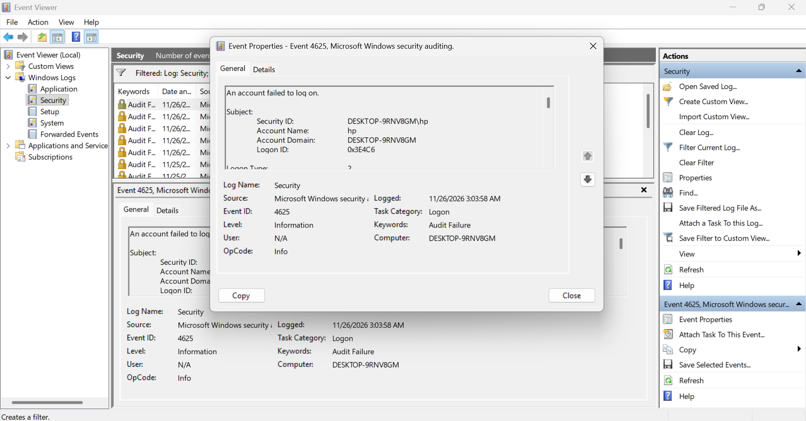
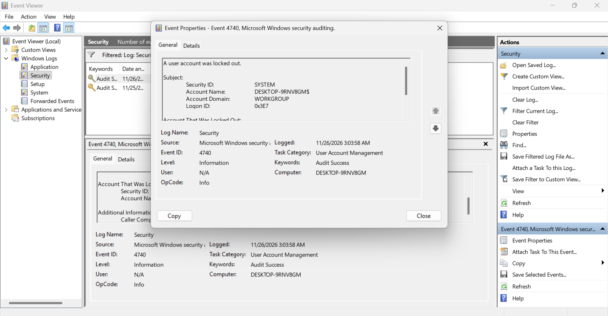
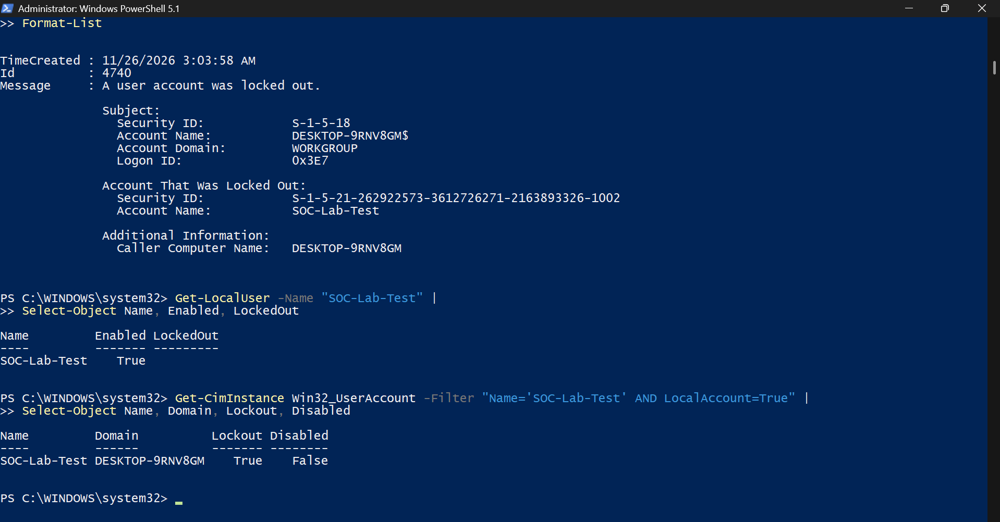
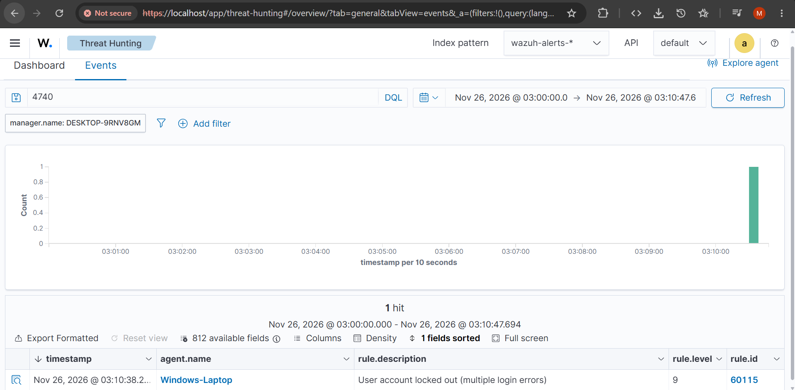
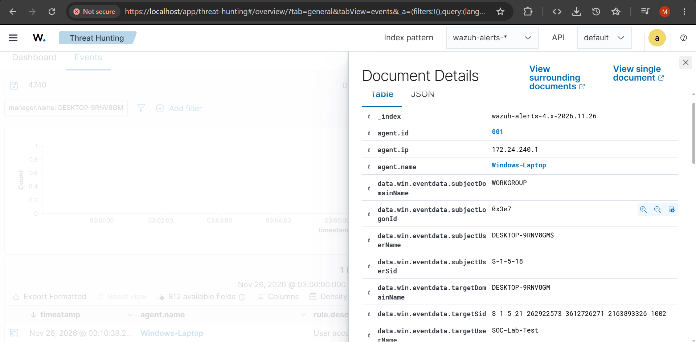
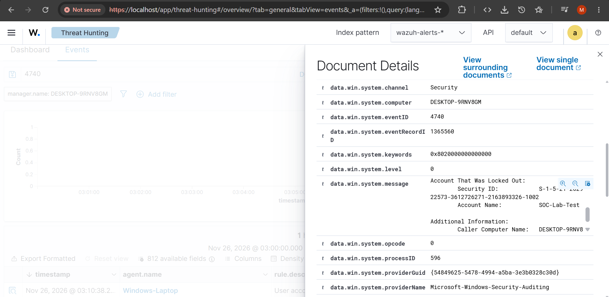
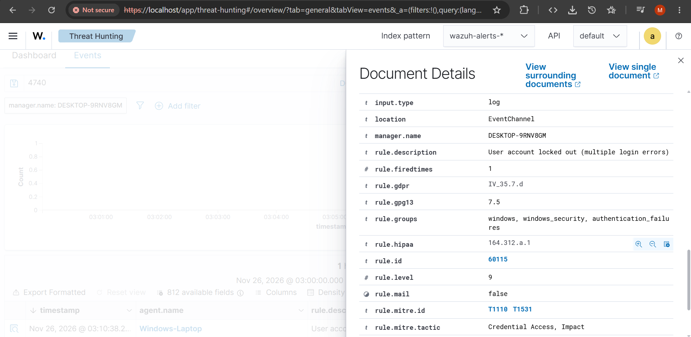

# 04. Windows Account Lockout Investigation

## 1. Project Overview

This project documents a hands-on SOC Analyst investigation into Windows account lockout events using Windows Security Logs, PowerShell, and Wazuh SIEM.

The investigation involved generating controlled failed authentication attempts against a local Windows test account, examining Windows Security Event IDs 4625 and 4740, verifying the account lockout state, and analyzing the corresponding Wazuh alert.

The purpose was to understand how repeated authentication failures can trigger an account lockout and how a SOC Analyst can investigate and document the resulting security events.

## 2. Lab Objectives

- Generate controlled failed authentication attempts against a Windows test account.
- Examine Windows Security Event ID 4625 (An account failed to log on).
- Identify Windows Security Event ID 4740 (A user account was locked out).
- Verify the account lockout state using PowerShell.
- Investigate the corresponding alert in Wazuh SIEM.
- Document findings using a SOC investigation approach.

## 3. Lab Environment

| Component | Description |
|---|---|
| Operating System | Windows |
| SIEM Platform | Wazuh |
| Endpoint Agent | Windows-Laptop |
| Agent ID | 001 |
| Test Account | SOC-Lab-Test |
| Account Lockout Threshold | 5 attempts |
| Account Lockout Duration | 30 minutes |
| Windows Event Viewer | Windows Security Logs |
| PowerShell | Windows PowerShell |

### Tools Used

- Wazuh SIEM
- Windows Event Viewer
- Windows Security Logs
- Windows PowerShell
- Windows Local User Account Management

## 4. Investigation Screenshots

### 4.1 Windows Failed Authentication Events

The Windows Security logs were examined for Event ID 4625, which records failed logon attempts. The events identified the test account, authentication failure details, logon type, and source address.

**Evidence 05 — Windows Event ID 4625**

### 4.2 Windows Account Lockout Event

Event ID 4740 was identified in the Windows Security logs. This event confirmed that the local test account, SOC-Lab-Test, had been locked out following repeated failed authentication attempts.

**Evidence 06 — Windows Event ID 4740**

### 4.3 Account Lockout Verification Using PowerShell

PowerShell and the Windows CIM interface were used to verify the account's lockout status.

The account returned `Lockout = True` and `Disabled = False`, confirming that it was locked rather than disabled.

**Evidence 07 — Account Lockout Status**

### 4.4 Wazuh SIEM Investigation

The Wazuh SIEM dashboard was used to investigate the account lockout alert generated from the Windows endpoint.

The investigation identified the corresponding detection rule and provided additional event and account details for analysis.

**Evidence 08 — Wazuh Alert Overview**

**Evidence 09 — Wazuh Event Details**

**Evidence 10 — Wazuh Account Details**

**Evidence 11 — Wazuh Detection Rule Details**

## 5. Investigation Findings

### Detection Summary

The investigation successfully demonstrated how repeated failed authentication attempts against a local Windows account can trigger an account lockout.

Five Event ID 4625 records for the test account were identified within the configured 30-minute observation window. An Event ID 4740 record subsequently confirmed the account lockout.

The account's lockout state was independently verified through PowerShell, and Wazuh detected the corresponding security event.

### Alert Details

| Field | Finding |
|---|---|
| Affected Account | SOC-Lab-Test |
| Endpoint | Windows-Laptop |
| Agent ID | 001 |
| Failed Logon Event | 4625 |
| Account Lockout Event | 4740 |
| Wazuh Rule ID | 60115 |
| Wazuh Rule Level | 9 |
| Wazuh Rule Description | User account locked out (multiple login errors) |
| Account Lockout Status | True |
| Account Disabled | False |
| Source Address | ::1 |
| Authentication Package | Negotiate |
| Logon Process | seclogo |

### Analysis

- Five failed authentication event records (Event ID 4625) were identified for SOC-Lab-Test.
- The failed authentication records contained status code `0xC000006D` and substatus code `0xC000006A`, indicating an authentication failure associated with an incorrect password.
- Event ID 4740 confirmed that Windows had locked out the test account.
- The PowerShell CIM query independently confirmed that the account was locked and not disabled.
- Wazuh generated an alert under Rule ID 60115 with a severity level of 9.
- The alert demonstrated that Wazuh could detect and report the Windows account lockout event from the monitored endpoint.

### Investigation Conclusion

The investigation successfully demonstrated the relationship between repeated failed authentication attempts and Windows account lockout detection.

Windows Security Event IDs 4625 and 4740 provided the evidence needed to identify the failed authentication activity and confirm the resulting account lockout.

PowerShell provided independent verification of the account state, while Wazuh SIEM supplied centralized alert visibility and detection details.

This exercise strengthened practical understanding of Windows authentication monitoring, security event analysis, SIEM alert investigation, and SOC incident documentation.

**Investigation Status:** Completed
